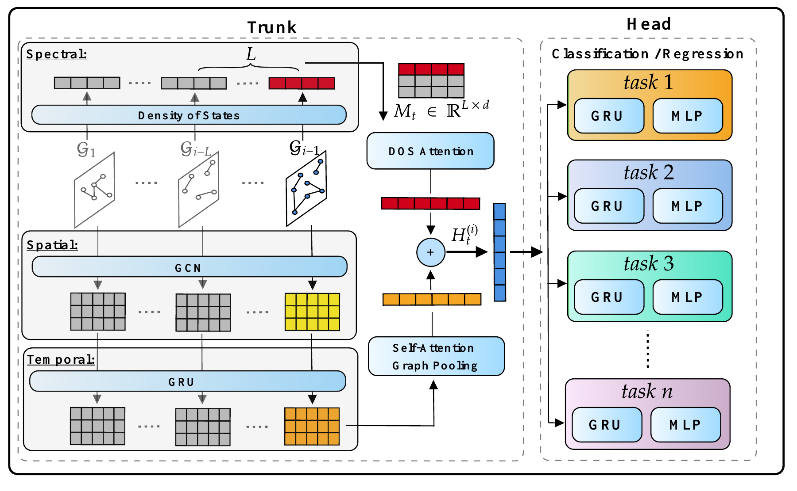

<p align="center">
  
</p>
<h1 align="center">Hydra</h1>
<p align="center"><strong>Towards Transferable Multi-Task Learning on Temporal Graphs</strong></p>
<p align="center">Learn across networks. Predict multiple properties. Transfer to unseen graphs.</p>
<p align="center">
  <a href="#overview">Overview</a> ·
  <a href="#results">Results</a> ·
  <a href="#installation">Installation</a> ·
  <a href="#data-and-configuration">Data &amp; configuration</a> ·
  <a href="#training-and-evaluation">Run Hydra</a>
</p>

## Overview

Hydra learns transferable representations of evolving networks by combining **local temporal connectivity** with **global spectral structure**. A shared representation supports task-specific prediction heads, allowing multiple graph properties to be learned jointly and evaluated on unseen networks without fine-tuning.

This repository contains the research implementation, classification and regression experiments, model components, and spectral feature utilities.

<p align="center">
  
</p>
<p align="center"><em>Hydra's spatial, temporal, and spectral learning paths. <a href="docs/assets/architecture.pdf">Vector figure</a>.</em></p>

| Component | Role |
| --- | --- |
| Temporal graph encoder | Captures changes in local connectivity across snapshots. |
| Density of States + attention | Summarizes global structure and its temporal evolution. |
| Shared representation | Combines information across the two perspectives. |
| Task-specific heads | Predict graph properties through classification or regression. |

The paper studies growth/shrinkage of edges, nodes, and the largest connected component, alongside regression of edge count, new nodes, and influential nodes.

## Installation

Use a dedicated **Python 3.10** environment as a starting point for the supplied dependency versions. This cleanup preserves the recorded runtime pins; it does not upgrade the experimental stack. Installation and training have not been validated end to end in a fresh environment.

```bash
python3.10 -m venv .venv
source .venv/bin/activate
python -m pip install --upgrade pip
```

On Windows, activate with `.venv\Scripts\Activate.ps1` in PowerShell.

1. Install **PyTorch 2.0.1** and matching **torch-scatter 2.1.1 / torch-sparse 0.6.17** wheels for your operating system and CPU/CUDA build. Use the [PyTorch previous-version instructions](https://pytorch.org/get-started/previous-versions/) and [PyG installation guide](https://pytorch-geometric.readthedocs.io/en/latest/install/installation.html). Do not mix extension wheels from a different PyTorch/CUDA version.
2. Install the project from this repository's root:

   ```bash
   python -m pip install -r requirements.txt
   python -m pip install --no-deps --no-build-isolation -e .
   python -m pip check
   ```

`kmapper` and `torch-geometric-pool` are required by imports in the source but were absent from the original dependency export. Their original versions are unknown; the requirements leave them unpinned rather than inventing a tested version. Verify and record these versions in your working experiment environment before claiming exact reproducibility. The `tgp` import comes from [Torch Geometric Pool](https://torch-geometric-pool.readthedocs.io/en/stable/).

The full original environment is retained in [requirements/environment-original.txt](requirements/environment-original.txt) for provenance. It includes notebook tooling and Windows-only packages and is **not** the portable installation entry point. Optional dependencies for auxiliary DOS utilities are listed separately in [requirements/optional.txt](requirements/optional.txt).

## Data and configuration

The original project points to the [MiNT benchmark dataset](https://zenodo.org/records/15364297). Datasets and pretrained checkpoints are not bundled here.

**Before running:** edit `DATA_PATH` in [script/configs/data_spec.py](script/configs/data_spec.py) to point to your local prepared dataset root. Its shipped value, `Data_Path`, is a placeholder. Prefer an absolute path. The `SAVED_MODEL_PATH` placeholder is retained, but the main Hydra scripts read/write checkpoints under `DATA_PATH/output/ckpts`.

The loader expects these files relative to `DATA_PATH`:

| Path | Contents |
| --- | --- |
| `TGS_available_datasets.csv` | Dataset index with a `token_name` column. |
| `TGS_available_datasets_social.csv` | Social dataset index with a `social_name` column. |
| `input/raw/edgelists/<dataset>_edgelist.txt` | CSV-formatted edges including `snapshot`, `source`, `destination`, and `weight`. |
| `input/raw/labels/<task>/<dataset>_<task>_labels.csv` | Headerless per-snapshot labels for each enabled task. |
| `input/cached/<dataset>/` | Generated graph caches. |
| `input/cached_feat/<dataset>/` | Generated node/graph and DOS feature caches. |
| `output/log/`, `output/results/`, `output/ckpts/` | Logs, metrics, and checkpoints. |

Create the three output directories before launching an experiment. The loader reads both index CSVs on an uncached load. Use the prepared edge lists and labels; the raw-data fallback has an existing unresolved path issue described in [review notes](docs/REVIEW.md).

### Select prediction tasks

The shipped [script/utils/tgf_param.py](script/utils/tgf_param.py) enables **only node growth/shrinkage**. This default is preserved. To run the three classification tasks, explicitly configure:

```python
supported_properties = {
    "edge_gs": "Edge_GS",
    "node_gs": "Node_GS",
    "lconcomp_gs": "LargeConComp_GS",
}
supported_properties_type = ["BC", "BC", "BC"]
```

Use the regression task names already documented in that file for regression experiments. Preserve dictionary order and keep the type list aligned; classification tasks must precede regression tasks when combined. Training and evaluation must use identical task and model configurations.

## Training and evaluation

Run commands from the repository root, after preparing the data and configuration. Module execution preserves the existing `script.*` imports. These are launch examples, not a complete reproduction of every paper experiment.

### Classification

```bash
python -m script.fm.Classification.Train.Hydra.Hydra_train \
  --data_pack_train pack_32 --seed 1024 --lr 2e-4 --max_epoch 500

python -m script.fm.Classification.Test.Hydra.Hydra_test \
  --data_pack_train pack_32 --data_pack_test pack_test \
  --seed 1024 --lr 2e-4 --max_epoch 500
```

Evaluation locates the checkpoint by the training run's name. Match the model name, training pack, learning rate, epoch argument, seed, and architecture settings. Checkpoints live in `DATA_PATH/output/ckpts/`.

### Regression

After configuring regression tasks and their labels, use the paired SRC scripts:

```bash
python -m script.fm.Regression.Train.TGF_graph_cls_train_dos_attention_multi_tasks_regression_SRC \
  --data_pack_train pack_32 --seed 1024 --lr 2e-4 --max_epoch 500

python -m script.fm.Regression.Test.TGF_graph_cls_test_dos_attention_multi_tasks_regression_SRC \
  --data_pack_train pack_32 --data_pack_test pack_test \
  --seed 1024 --lr 2e-4 --max_epoch 500
```

## Repository guide

| Location | Purpose |
| --- | --- |
| `script/fm/Classification/{Train,Test}/Hydra/` | Main Hydra classification entry points. |
| `script/fm/Classification/{Train,Test}/Arxiv/` | Retained experimental variants. |
| `script/fm/Regression/` | Regression training and evaluation variants. |
| `script/nn/` | Encoders, attention, decoders, manifolds, and losses. |
| `script/utils/` | Arguments, data loading, task selection, and feature utilities. |
| `script/utils/DOS/` | Spectral preprocessing and auxiliary Python/MATLAB utilities. |
| `script/configs/` | Dataset packs, local path configuration|
| `docs/` | Paper assets and cleanup/review notes. |

## Citation

Author order below follows the supplied NeurIPS LaTeX source. Replace this manuscript entry with the final proceedings citation when available.

```bibtex
@inproceedings{shamsi2026hydra,
  title = {Hydra: Towards Transferable Multi-Task Learning on Temporal Graphs},
  author = {Kiarash Shamsi and Farimah Poursafaei and Tran Gia Bao Ngo
            and Reihaneh Rabbany and Baris Coskunuzer and Guillaume Rabusseau
            and Michael M. Bronstein and Shenyang Huang and Cuneyt Gurcan Akcora},
  booktitle = {Advances in Neural Information Processing Systems (NeurIPS)},
  year = {2026}
}
```
